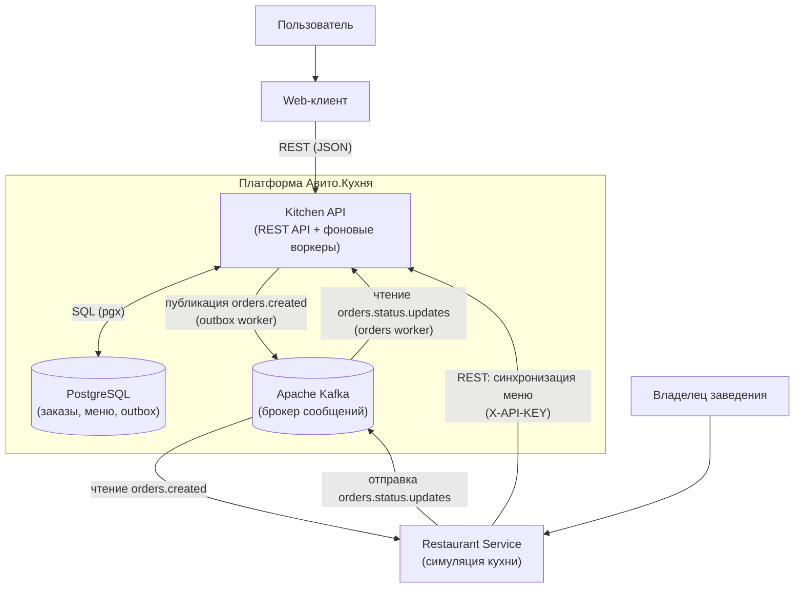

## Архитектура (C4, Level 2)

### Контейнеры

- **Web-клиент**: интерфейс покупателя для просмотра меню, оформления заказов и проверки их статуса.
- **Kitchen API**: основной Go-сервис. Обрабатывает входящие HTTP-запросы, выполняет бизнес-логику и запускает фоновые горутины (Outbox Worker для отправки заказов в Kafka и Orders Worker для вычитки смены статусов из Kafka).
- **PostgreSQL**: реляционная БД для хранения заведений, позиций меню, заказов, аудита статусов (`order_events`) и таблицы очередей (`outbox_events`).
- **Apache Kafka**: брокер сообщений для асинхронного обмена событиями между платформой и кухней ресторана:
  - `orders.created` — события создания новых заказов.
  - `orders.status.updates` — события смены статусов приготовления от заведений.
- **Restaurant Service (`restaurant-example`)**: автономный Go-сервис кухни. При старте синхронизирует меню по REST, затем слушает `orders.created` из Kafka и асинхронно пушит статусы готовки в `orders.status.updates`.
