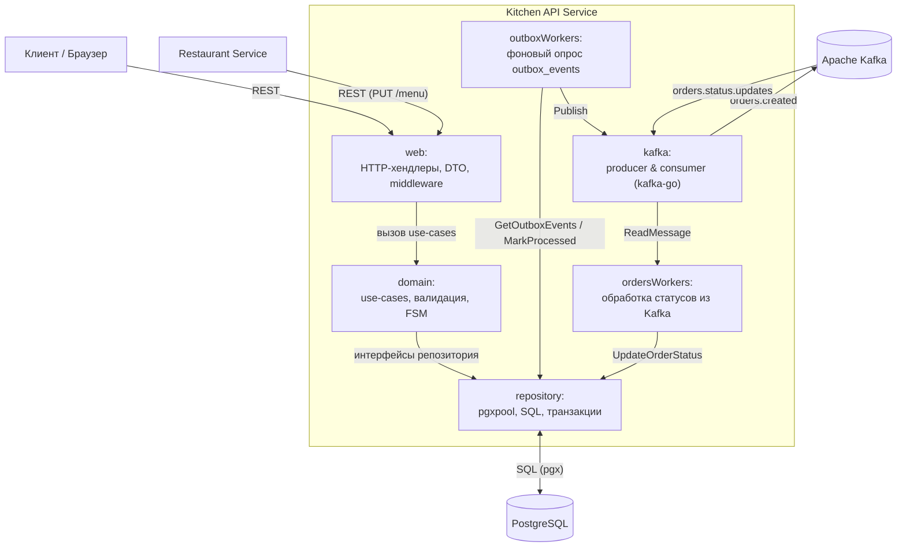

## Архитектура (C4, Level 3)

### Внутренние компоненты сервиса

1. **`web`**: приём входящих HTTP-запросов, валидация DTO, проверка `X-API-KEY` заведений, вызов бизнес-логики.
2. **`domain`**: ядро бизнес-логики (`OrderService`, `PartnerService`) и матрица допустимых переходов конечного автомата (`CanTransition`).
3. **`repository`**: реализация интерфейсов доступа к PostgreSQL на `jackc/pgx/v5`. Атомарно сохраняет заказы и записи в `outbox_events` в единой транзакции, блокирует строки через `FOR UPDATE` и выбирает пачки событий с `FOR UPDATE SKIP LOCKED`.
4. **`outboxWorkers`**: фоновая горутина, опрашивающая таблицу `outbox_events` каждые 5 секунд и отправляющая события создания заказов в топик Kafka `orders.created`.
5. **`ordersWorkers`**: фоновая горутина, вычитывающая события смены статусов заказов из топика Kafka `orders.status.updates` и передающая их в репозиторий для обновления в БД.
6. **`kafka`**: обёртка над библиотекой `segmentio/kafka-go` для создания `Producer` и `Consumer`.
