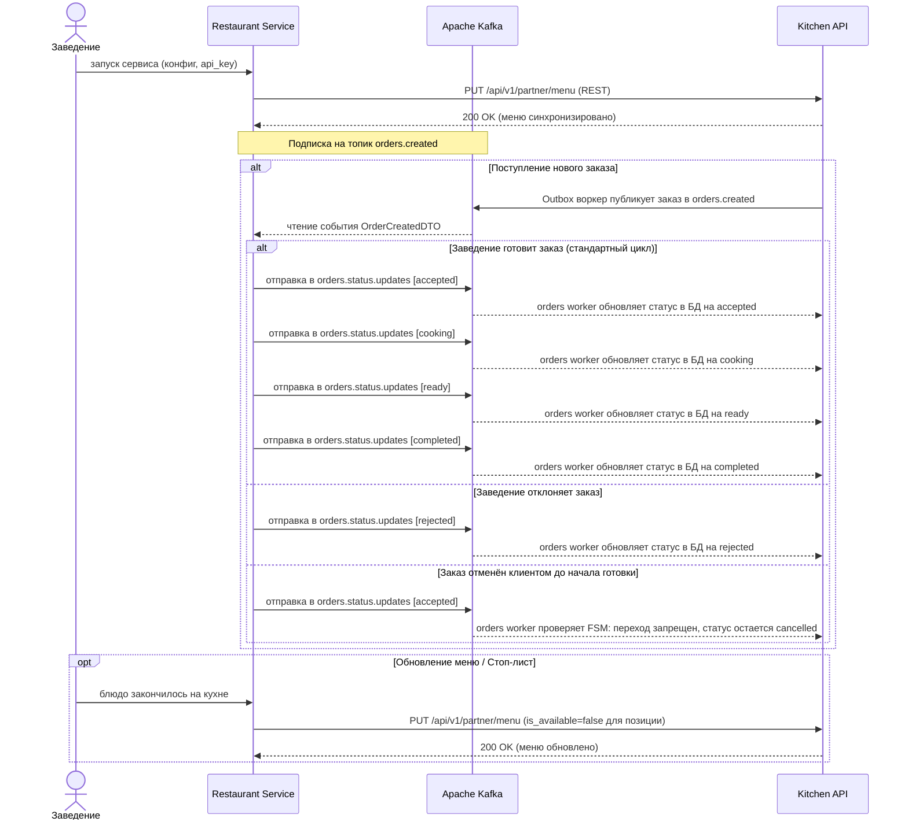

# CJM заведения

## Путь заведения (EDA)

### Пояснения к сценарию

1. **Синхронизация меню**: при старте сервис кухни отправляет текущее меню через идемпотентный REST-запрос (`PUT /api/v1/partner/menu`) с заголовком `X-API-KEY`.
2. **Получение заказов**: вместо постоянных HTTP-запросов (поллинга) кухня подписана на топик Kafka `orders.created` и моментально получает созданные заказы.
3. **Обновление статусов**: кухня публикует этапы готовки (`accepted -> cooking -> ready -> completed`) в топик Kafka `orders.status.updates`. Воркер `kitchen-api` считывает их и обновляет запись в базе данных.
4. **Защита от конфликтов (FSM)**: если клиент уже отменил заказ в API, воркер `kitchen-api` при попытке перевести заказ в `accepted` отклоняет изменение через проверку конечного автомата, сохраняя статус `cancelled`.
