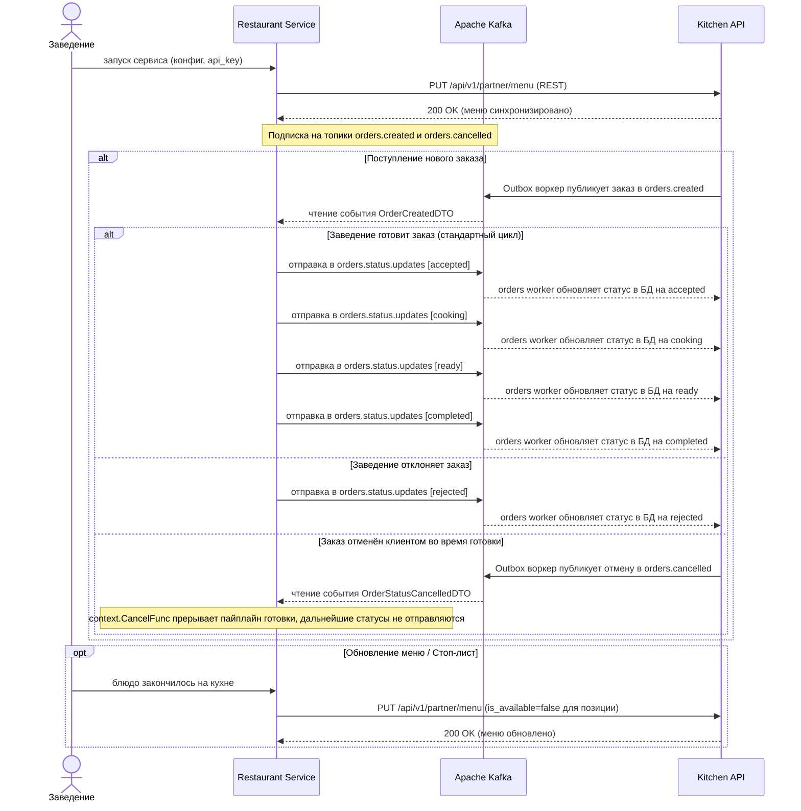

# CJM заведения

## Путь заведения (EDA)

### Пояснения к сценарию

1. **Синхронизация меню**: при старте сервис кухни отправляет текущее меню через идемпотентный REST-запрос (`PUT /api/v1/partner/menu`) с заголовком `X-API-KEY`.
2. **Получение заказов и отмен**: вместо постоянных HTTP-запросов (поллинга) кухня подписана на топики Kafka `orders.created` (создание заказов) и `orders.cancelled` (отмена заказов) и обрабатывает события асинхронно.
3. **Обновление статусов**: кухня публикует этапы готовки (`accepted -> cooking -> ready -> completed`) в топик Kafka `orders.status.updates`. Воркер `kitchen-api` считывает их и обновляет запись в базе данных.
4. **Обработка отмены заказа и защита FSM**: при отмене заказа клиентом событие через Outbox попадает в топик `orders.cancelled`. Сервис кухни по вычитке отмены вызывает `cancelFunc()` контекста активного заказа, немедленно прерывая горутину готовки и прекращая отправку статусов в API. Если статус `accepted` уже успел отправиться до обработки отмены, воркер `kitchen-api` защищён конечным автоматом (FSM) и сохраняет статус `cancelled`.
