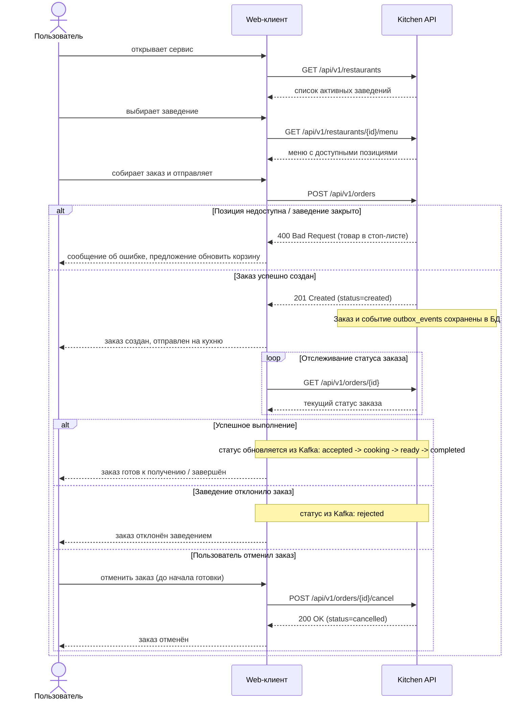

# CJM пользователя

## Путь пользователя

### Пояснения к сценарию

1. Клиент взаимодействует с сервисом через стандартный REST API.
2. При успешном создании заказа (`POST /api/v1/orders`) запись заказа и событие для кухни сохраняются в PostgreSQL атомарно в одной транзакции (паттерн Transactional Outbox).
3. Изменения статуса заказа на кухне приходят в `kitchen-api` асинхронно через шину Kafka и сохраняются в БД. Клиент видит актуальный статус при опросе `GET /api/v1/orders/{id}`.
4. Отмена клиентом доступна, пока заказ находится в статусе `created` или `accepted` (до перехода в `cooking`).
