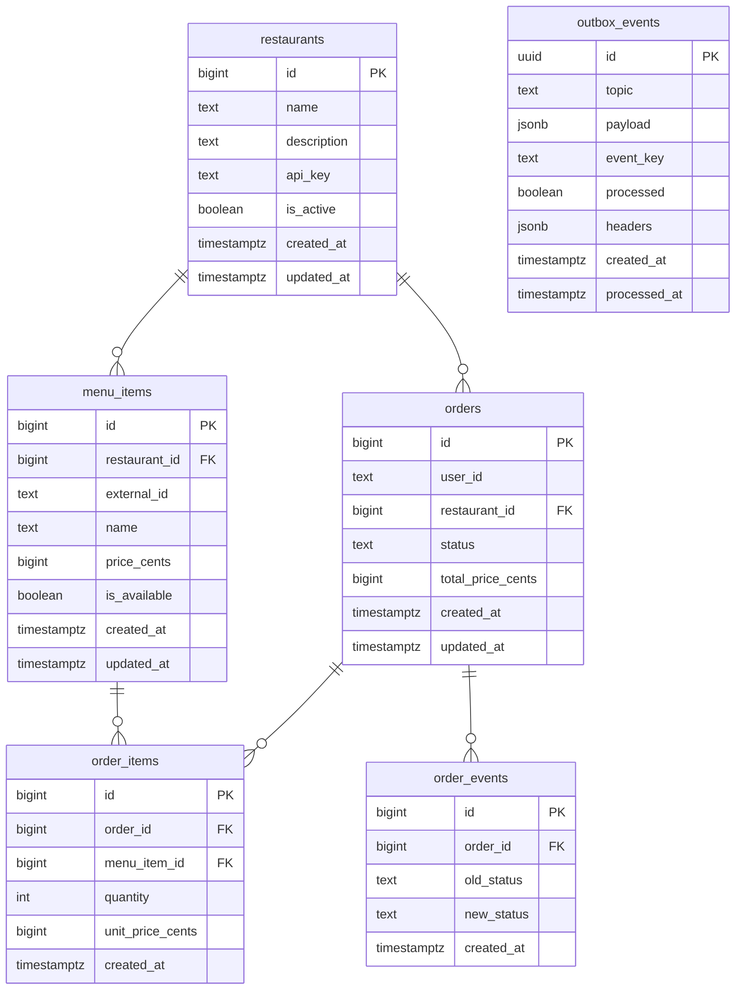

## Схема БД

### Таблицы

1. **`restaurants`** — заведения-партнеры платформы.
   - `api_key` — закрытый ключ для авторизации партнера (`X-API-KEY`).
   - `is_active` — флаг доступности заведения. Частичный индекс `idx_restaurants_is_active ON (is_active) WHERE is_active = TRUE`.

2. **`menu_items`** — блюда заведений.
   - `price_cents` — цена в минимальных неделимых единицах (копейках).
   - `external_id` — уникальный строковый артикул блюда со стороны ресторана (`UNIQUE(restaurant_id, external_id)` для безопасного upsert).
   - Индекс `idx_menu_items_restaurant_lookup ON (restaurant_id, is_available)` для быстрого получения доступного меню.

3. **`orders`** — заказы клиентов.
   - `status` — текущий статус (`created`, `accepted`, `rejected`, `cooking`, `ready`, `completed`, `cancelled`).
   - Индексы: `idx_orders_user_created ON (user_id, created_at DESC)` (история пользователя), `idx_orders_restaurant_status ON (restaurant_id, status)`.

4. **`order_items`** — состав заказа.
   - `unit_price_cents` — цена блюда, зафиксированная на момент создания заказа (Snapshot Pricing).

5. **`order_events`** — аудит изменений статусов заказа.
   - Каждая смена статуса фиксируется записью `(order_id, old_status, new_status, created_at)`.

6. **`outbox_events`** — таблица для паттерна Transactional Outbox.
   - При оформлении заказа запись о событии кладется в `outbox_events` в одной транзакции с заказом (`orders`).
   - Частичный индекс: `idx_outbox_unprocessed ON (created_at) WHERE processed = false` для быстрой выборки необработанных событий фоновым воркером (`FOR UPDATE SKIP LOCKED`).
